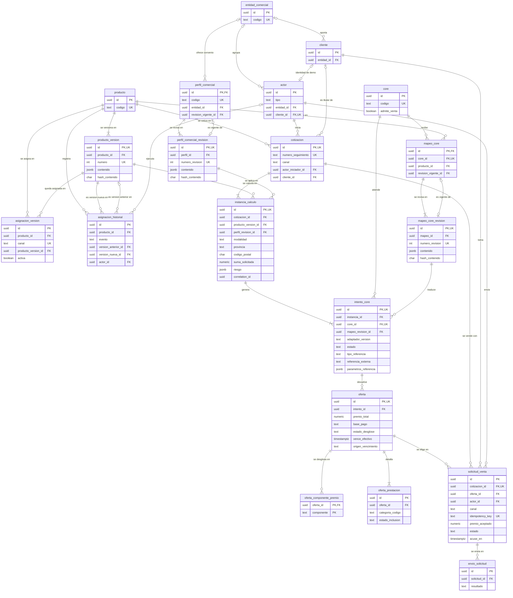
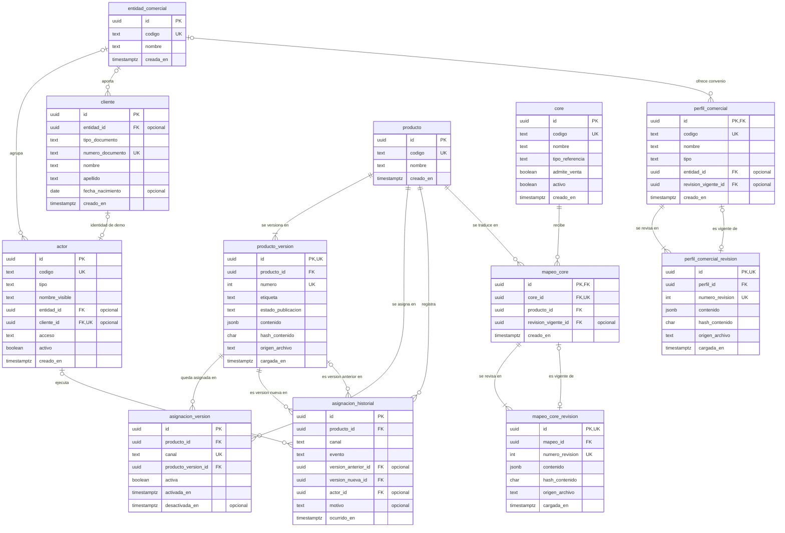
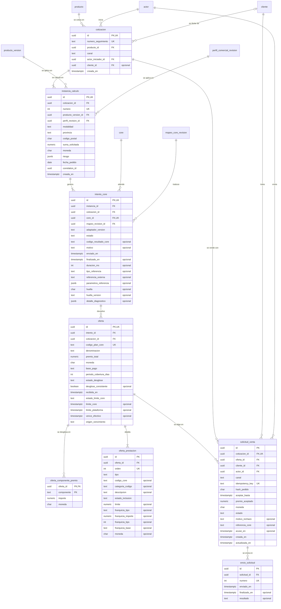

# Esquema relacional y DER del backend intermediario

Segunda entrega del TPI. **Estado: borrador para revisión.** Este documento presenta el esquema PostgreSQL propuesto para el Nivel 1 del cotizador de Movilidad, acotado a lo que una persona puede construir, probar y defender. Se basa en el [acta](../../fuentes/entrega-01/acta-constitucion.md), el [anexo técnico 2.2](../../fuentes/entrega-01/anexo-tecnico-v2-2.md), el [alcance por niveles](../../refinamiento/alcance-por-niveles-y-bases-de-extension.md) y las decisiones [DER-02](../../refinamiento/decisiones-der-02-perfil-y-vigencia.md) y [DER-03](../../refinamiento/decisiones-der-03.md). El detalle de cada campo está en el [diccionario de datos](02-diccionario-de-datos.md) y los responsables de cada operación, en el [listado de módulos](03-modulos.md).

| Marca | Significado |
| --- | --- |
| **A** | Aprobado. Está registrado en un documento aprobado o se acordó en la revisión. |
| **P** | Propuesta N1. Es candidata hasta su aprobación. |
| **PN-xx** | Propuesta N1 surgida al redactar este borrador. Se detalla en la sección 11 y se registra en DER-03 §9. |
| **D** | Diferido. Queda fuera del Nivel 1; se indica qué se conserva desde ahora. |
| **CP** | Depende de un contrato de core todavía preliminar. La sección 12 indica cuál y qué pasa si cambia. |

## 1 Alcance del modelo

- **Base del intermediario.** El DER modela solamente la base PostgreSQL del backend. El modelo canónico define qué significan los datos de cotización y oferta. Los contratos JSON de cada core documentan el intercambio con esa integración. El almacenamiento del simulador de A se describe aparte, en la sección 8.
- **N cores, dos en la demo.** Core A y Core B son filas de la tabla `core`. Cada llamada a un core es un `intento_core` con la misma estructura. Agregar un core suma una fila, un mapeo y un adaptador; no agrega tablas.
- **Un intento por core.** En el Nivel 1, cada cálculo registra un intento por core habilitado con su resultado. Los reintentos de cotización, la publicación progresiva de ofertas y los avisos por ofertas tardías pasan al Nivel 2.
- **Sobre común y riesgo específico.** Los datos comunes a cualquier cotización de Movilidad (modalidad, provincia, código postal y suma solicitada) son columnas de `instancia_calculo`. Los atributos propios de cada modalidad viajan en `riesgo` (`jsonb`), validado por el JSON Schema de la versión de producto. Así se aplican los principios PR-02 y PR-03 del anexo.
- **Configuración desde Git.** Las versiones de producto, las revisiones de perfil y las revisiones de mapeo se escriben como archivos en Git. `db-setup` las valida y las carga como filas inmutables.
- **Datos sintéticos.** Todas las identidades, clientes y documentos son sintéticos. Las vistas de consulta exponen códigos de actor, nunca documentos completos.

## 2 Decisiones que usa el esquema

| Decisión | Marca | Fuente | Dónde impacta |
| --- | --- | --- | --- |
| Perfiles preparados (estándar y convenio de Banco A) y revisión de perfil aplicada conservada | **A** | DER-02, decisión 2 | `perfil_comercial`, `perfil_comercial_revision`, `instancia_calculo.perfil_revision_id` |
| Plazo de aceptación por oferta, menor límite válido y aviso cuando la regla de plataforma supera al core | **A** | DER-02, decisión 3; DER-03 §3 | Columnas de vigencia de `oferta`, vista `v_aviso_plazo_ajustado` |
| La ficha respalda la regla de plazo y el mapeo la concreta por core y plan | **A** | DER-03 §3 | `mapeo_core_revision.contenido` |
| Versiones y revisiones publicadas inmutables | **A** | Anexo PR-06 | Triggers de inmutabilidad, `ON DELETE RESTRICT` |
| Activación y rollback cambian la asignación y dejan historial | **A** | Acta; anexo §11 | `asignacion_version`, `asignacion_historial` |
| `db-setup` reutiliza el mismo contenido y rechaza otro contenido con la misma revisión | **A** | Inicialización local | Claves de revisión y `hash_contenido` |
| La oferta debe estar vigente al registrar la solicitud | **A** | Refinamiento 4.10 | Validación transaccional de `solicitud_venta` |
| La cotización guarda el número público; la instancia, el riesgo y las revisiones usadas | **P** | DER-03 §1 | `cotizacion`, `instancia_calculo` |
| Una instancia por cotización y un intento por core; sin reintentos ni referencias de origen | **P** | DER-03 §1 | `UNIQUE (instancia_id, core_id)` en `intento_core` |
| Respuesta sincrónica con timeout de cotización de 2 s por core | **P** | DER-03 §1 | Duración y estado de cada intento |
| Revisión de mapeo resuelta y validada por producto y core antes de registrar el intento | **P** | DER-03 §1 | `intento_core.mapeo_revision_id`, sin restricciones adicionales |
| Versión de producto y revisión de perfil verificadas al crear la cotización | **P** | DER-03 §1 | Comparación previa a insertar `cotizacion` |
| Una tabla de solicitudes; no hay tabla de venta | **P** | DER-03 §2.1 | `solicitud_venta` |
| Una bicicleta por cotización | **P** | DER-03 §2.1 | Una cotización, un bien; `riesgo` por instancia |
| Una venta exitosa por seguimiento | **P** | DER-03 §2.1 | Índice único parcial en `solicitud_venta` |
| A vende, B compara | **P** | DER-03 §2.1 | `core.admite_venta` |
| Cliente identificado para confirmar | **P** | DER-03 §2.1 | `solicitud_venta.cliente_id NOT NULL` y FK compuesta a `cotizacion` |
| Acuse `RECIBIDA` de A como registro de la venta | **P** · CP | DER-03 §2.2 | `solicitud_venta.acuse_en`, `referencia_core` |
| `RECIBIDA` y `RECHAZADA` son estados finales | **P** | DER-03 §2.3 | Actualización condicional del desenlace |
| Timeout de envío de 3 s, umbral de 5 s y reenvío de la misma solicitud | **P** · CP | DER-03 §2.4 | `envio_solicitud`, vista `v_solicitud_sin_resolver` |
| Reenvíos concurrentes: el timeout queda en su envío y la venta se cuenta una vez | **P** · CP | DER-03 §2.4, caso 3 | `envio_solicitud`, estados finales |
| Pedido a A reconstruido con datos inmutables; cliente sintético fijo durante la demo | **P** · CP | DER-03 §2.4 | `solicitud_venta`, `oferta`, `intento_core.referencia_externa`, `cliente` |
| `aceptarHasta` en la solicitud a A | **P** · CP | DER-03 §5 | `solicitud_venta.aceptar_hasta` |
| La duración de un plazo se cuenta desde que el backend registra la respuesta | **P** | DER-03 §3 | `oferta.recibida_en` |
| Oferta sin límite válido, o con límite del core inválido: comparable, no confirmable | **P** · CP | DER-03 §3 | `origen_vencimiento = 'DESCONOCIDO'`, `vence_efectivo` vacío |
| Aviso de plazo como consulta del responsable | **P** | DER-03 §3 | Vista `v_aviso_plazo_ajustado` |
| Una asignación activa por producto y canal | **P** | DER-03 §4 | Índice único parcial en `asignacion_version` |
| Revisión identificada dentro de su perfil o mapeo | **P** | DER-03 §4 | `UNIQUE (perfil_id, numero_revision)`, `UNIQUE (mapeo_id, numero_revision)` |
| Estados canónicos del intento y equivalencias por core | **P** · CP | DER-03 §5 | `intento_core.estado` |

## 3 Tablas

| Grupo | Tabla | Qué representa | Clave principal | Marca |
| --- | --- | --- | --- | --- |
| Contexto | `entidad_comercial` | Entidad ficticia que aporta clientes, operadores o un convenio, como Banco A. | `id` | P |
| Contexto | `actor` | Identidad sintética de la botonera: visitante, cliente, operador o responsable de configuración. | `id` | P |
| Contexto | `cliente` | Persona sintética que puede ser tomador y asegurado. Sus datos no cambian durante la demo. | `id` | P |
| Catálogo | `producto` | Familia de producto. En el Nivel 1, solo Movilidad. | `id` | P |
| Catálogo | `producto_version` | Versión funcional instalada, como Movilidad v1 y v2, con su ficha, experiencia y esquema de riesgo. | `id` | A (inmutable) |
| Versiones | `asignacion_version` | Qué versión atiende las nuevas cotizaciones de un producto y canal, y desde cuándo. | `id` | P |
| Versiones | `asignacion_historial` | Registro de cargas iniciales, activaciones y rollbacks. Solo admite inserciones. | `id` | A |
| Configuración | `perfil_comercial` | Perfil comercial preparado, como estándar o convenio de Banco A. | `id` | A |
| Configuración | `perfil_comercial_revision` | Revisión inmutable de las condiciones de un perfil. | `id` | A |
| Integración | `core` | Catálogo de cores con sus capacidades. | `id` | P |
| Integración | `mapeo_core` | Mapeo de un producto hacia un core. | `id` | P |
| Integración | `mapeo_core_revision` | Revisión inmutable de las traducciones y los plazos por plan de un mapeo. | `id` | P |
| Operación | `cotizacion` | Seguimiento que ve la persona, con su número público. | `id` | P |
| Operación | `instancia_calculo` | Cálculo de una cotización, con el riesgo y las versiones usadas. Una por cotización en el Nivel 1. | `id` | P |
| Operación | `intento_core` | Llamada a un core dentro de una instancia. Una por core en el Nivel 1. | `id` | P |
| Operación | `oferta` | Cada plan devuelto por un core, con premio, desglose y vigencia. | `id` | A (vigencia) / P |
| Operación | `oferta_componente_premio` | Componentes del desglose que informó el core. | `(oferta_id, componente)` | P |
| Operación | `oferta_prestacion` | Coberturas y asistencias de cada oferta. | `id` | PN-10 |
| Venta | `solicitud_venta` | Solicitud de venta simulada sobre la oferta exacta elegida. | `id` | P |
| Venta | `envio_solicitud` | Historial mínimo de cada envío o reenvío de una solicitud a A. | `id` | PN-02 |

Además de las tablas, el esquema define cuatro vistas de consulta: `v_oferta_estado`, `v_solicitud_sin_resolver`, `v_aviso_plazo_ajustado` y `v_evento_negocio`. Se describen en la sección 6.6 y en el diccionario.

## 4 DER

El DER se presenta en dos vistas del mismo modelo. Las dos tienen las mismas 20 tablas y las mismas 34 relaciones; cambia solo la cantidad de campos que se muestran. Las reglas de negocio de la sección 5 valen para ambas.

Convención de los diagramas: la entidad de la izquierda es la referenciada y la de la derecha guarda la clave foránea. `||` indica exactamente uno, `|o` cero o uno, `|{` uno o más y `o{` cero o más. Una relación opcional usa `|o` del lado referenciado. `PK`, `FK` y `UK` marcan clave principal, columna que forma parte de una clave foránea y columna que forma parte de una restricción de unicidad. Los tipos se muestran sin precisión; el diccionario indica, por ejemplo, `numeric(14,2)` o `char(64)`.

### 4.1 Vista resumida para la defensa

Esta vista muestra todas las tablas y relaciones, pero solo los campos que explican la mejora propuesta en el acta. La tabla siguiente indica qué campos responden a cada indicador.

| Indicador o propósito del acta | Campos que lo muestran |
| --- | --- |
| Reutilización: un recorrido para cliente y operador, y para las dos modalidades | `actor.tipo`, `cotizacion.canal`, `cotizacion.actor_iniciador_id`, `instancia_calculo.modalidad` |
| Dónde vive la definición y dónde los valores ingresados | Definición versionada: `producto_version.contenido` (ficha y esquema de riesgo), `perfil_comercial_revision.contenido` (condiciones del perfil), `mapeo_core_revision.contenido` (traducciones y plazos por core). Valores ingresados: `instancia_calculo.riesgo`, validado con el esquema de la versión usada. |
| Integración: dos cores con contratos distintos por el mismo puerto | `core.codigo`, `core.admite_venta`, `mapeo_core.core_id`, `intento_core.core_id`, `intento_core.estado`, `oferta.estado_desglose` |
| Diferencia entre A y B al guardar la referencia del core | `intento_core.tipo_referencia`; A deja su identificador en `intento_core.referencia_externa`; B, volátil, deja los datos para volver a cotizar en `intento_core.parametros_referencia` |
| Comparación sobre el mismo escenario | `instancia_calculo.provincia`, `instancia_calculo.codigo_postal`, `instancia_calculo.suma_solicitada`, `oferta.premio_total`, `oferta.base_pago` |
| Versiones, activación y rollback | `producto_version.numero`, `asignacion_version.canal`, `asignacion_version.producto_version_id`, `asignacion_version.activa`, `asignacion_historial.evento` |
| Revisiones aplicadas e inmutables | `producto_version.hash_contenido`, `perfil_comercial_revision.hash_contenido`, `mapeo_core_revision.hash_contenido`, `instancia_calculo.producto_version_id`, `instancia_calculo.perfil_revision_id`, `intento_core.mapeo_revision_id`, `intento_core.adaptador_version` |
| Trazabilidad de cada operación | `cotizacion.numero_seguimiento`, `instancia_calculo.correlation_id`, `intento_core.id`, `oferta.id`, `solicitud_venta.id` |
| Atribución de la venta | `solicitud_venta.actor_id` (quién envió la solicitud), `solicitud_venta.canal` (canal de quien la envió), `solicitud_venta.premio_aceptado` (importe aceptado) |
| Consistencia: cero ventas duplicadas | `solicitud_venta.idempotency_key`, `solicitud_venta.cotizacion_id`, `solicitud_venta.oferta_id`, `solicitud_venta.estado`, `solicitud_venta.acuse_en`, `envio_solicitud.resultado` |
| Vigencia de la oferta | `oferta.vence_efectivo`, `oferta.origen_vencimiento` |

### 4.2 DER completo: catálogo y configuración

Todos los campos de las tablas de contexto, catálogo, versiones, configuración comercial e integración. Coinciden uno a uno con el [diccionario](02-diccionario-de-datos.md). `"opcional"` marca los campos que admiten nulos.

### 4.3 DER completo: cotización, ofertas y venta

Todos los campos de las tablas de operación y venta. Las tablas de catálogo y configuración aparecen solo como destino de relaciones; sus campos están en la vista 4.2.

### 4.4 Relaciones

La columna «Lado referenciado» indica cuántas filas de la tabla destino corresponden a cada fila de origen. «Lado origen» indica cuántas filas de origen puede tener cada fila destino.

| # | Tabla origen | Clave foránea | Tabla destino | Lado referenciado | Lado origen | Marca |
| --- | --- | --- | --- | --- | --- | --- |
| 1 | `actor` | `entidad_id` | `entidad_comercial` | 0..1 | 0..N | P |
| 2 | `actor` | `cliente_id` | `cliente` | 0..1 | 0..1 | P |
| 3 | `cliente` | `entidad_id` | `entidad_comercial` | 0..1 | 0..N | P |
| 4 | `perfil_comercial` | `entidad_id` | `entidad_comercial` | 0..1 | 0..N | A |
| 5 | `perfil_comercial_revision` | `perfil_id` | `perfil_comercial` | 1 | 1..N | A |
| 6 | `perfil_comercial` | `(revision_vigente_id, id)` | `perfil_comercial_revision` | 0..1 | 0..1 | PN-01 |
| 7 | `producto_version` | `producto_id` | `producto` | 1 | 1..N | A |
| 8 | `asignacion_version` | `producto_id` | `producto` | 1 | 0..N | P |
| 9 | `asignacion_version` | `(producto_version_id, producto_id)` | `producto_version` | 1 | 0..N | P |
| 10 | `asignacion_historial` | `producto_id` | `producto` | 1 | 0..N | A |
| 11 | `asignacion_historial` | `(version_nueva_id, producto_id)` | `producto_version` | 1 | 0..N | A |
| 12 | `asignacion_historial` | `(version_anterior_id, producto_id)` | `producto_version` | 0..1 | 0..N | A |
| 13 | `asignacion_historial` | `actor_id` | `actor` | 0..1 | 0..N | A |
| 14 | `mapeo_core` | `core_id` | `core` | 1 | 0..N | P |
| 15 | `mapeo_core` | `producto_id` | `producto` | 1 | 0..N | P |
| 16 | `mapeo_core_revision` | `mapeo_id` | `mapeo_core` | 1 | 1..N | P |
| 17 | `mapeo_core` | `(revision_vigente_id, id)` | `mapeo_core_revision` | 0..1 | 0..1 | PN-01 |
| 18 | `cotizacion` | `producto_id` | `producto` | 1 | 0..N | P |
| 19 | `cotizacion` | `actor_iniciador_id` | `actor` | 1 | 0..N | P |
| 20 | `cotizacion` | `cliente_id` | `cliente` | 0..1 | 0..N | P |
| 21 | `instancia_calculo` | `cotizacion_id` | `cotizacion` | 1 | 1..N | P |
| 22 | `instancia_calculo` | `producto_version_id` | `producto_version` | 1 | 0..N | P |
| 23 | `instancia_calculo` | `perfil_revision_id` | `perfil_comercial_revision` | 1 | 0..N | A |
| 24 | `intento_core` | `(instancia_id, cotizacion_id)` | `instancia_calculo` | 1 | 1..N | P |
| 25 | `intento_core` | `core_id` | `core` | 1 | 0..N | P |
| 26 | `intento_core` | `mapeo_revision_id` | `mapeo_core_revision` | 1 | 0..N | P |
| 27 | `oferta` | `(intento_id, cotizacion_id)` | `intento_core` | 1 | 0..N | P |
| 28 | `oferta_componente_premio` | `oferta_id` | `oferta` | 1 | 0..N | P |
| 29 | `oferta_prestacion` | `oferta_id` | `oferta` | 1 | 1..N | PN-10 |
| 30 | `solicitud_venta` | `(oferta_id, cotizacion_id)` | `oferta` | 1 | 0..N | P |
| 31 | `solicitud_venta` | `(cotizacion_id, cliente_id)` | `cotizacion` | 1 | 0..N | PN-03 |
| 32 | `solicitud_venta` | `cliente_id` | `cliente` | 1 | 0..N | P |
| 33 | `solicitud_venta` | `actor_id` | `actor` | 1 | 0..N | P |
| 34 | `envio_solicitud` | `solicitud_id` | `solicitud_venta` | 1 | 0..N | PN-02 |

Notas sobre cardinalidad:

- **Una instancia por cotización en el Nivel 1.** La relación 21 admite varias instancias para no cambiarla cuando llegue la recotización, pero en el Nivel 1 cada cotización tiene exactamente una, con `numero = 1`.
- **Un intento por core.** `UNIQUE (instancia_id, core_id)` en `intento_core`. Una instancia tiene tantos intentos como cores habilite el perfil. No se crea una instancia si no hay ninguno; por eso la relación 24 es 1..N.
- **Una oferta, varias solicitudes en el tiempo.** Una oferta puede tener más de una solicitud solo si las anteriores terminaron en `RECHAZADA`. El índice parcial de la sección 6.4 impide dos solicitudes vigentes en el mismo seguimiento.
- **Oferta sin prestaciones.** Los dos contratos exigen al menos una cobertura por plan. Por eso la relación 29 es 1..N.
- **Mapeo del intento.** La relación 26 no obliga en la base a que la revisión pertenezca al mapeo del mismo core y producto. Lo garantiza el backend al resolverla antes de registrar el intento (sección 5, regla 3).

## 5 Reglas de negocio que el esquema hace cumplir

Estas reglas son independientes de PostgreSQL. La sección 6 indica cómo se implementan.

1. **Una cotización sigue un solo bien.** El riesgo se guarda en la instancia. Cambiar de bien abre otra cotización. **P**
2. **La instancia conserva lo que se usó.** Versión de producto, revisión de perfil, riesgo y suma solicitada quedan fijados en la instancia. Una activación posterior no los cambia. **P**
3. **Cada intento conserva su revisión de mapeo.** Antes de registrar el intento, el backend busca el mapeo del producto y el core, toma su revisión vigente y verifica que exista. Si falta, ese core no se invoca y la cotización sigue con los demás. **P**
4. **Un intento por core y resultado registrado.** Cada core habilitado tiene un intento con su desenlace: con ofertas, sin oferta, rechazo, datos inválidos, no soportado, falla temporal, timeout, respuesta inválida o error técnico. No hay reintentos en el Nivel 1. **P** · CP
5. **Cada oferta pertenece a un intento y a una cotización.** Una solicitud solo puede elegir una oferta de su misma cotización. **P**
6. **La vigencia de la oferta es explícita.** Se guarda el límite del core, el límite de plataforma, el vencimiento efectivo y su origen. Se aplica el menor límite válido. Si la regla de plataforma supera al core, se aplica el core y queda un aviso. Sin un límite válido, incluido un límite del core inválido, el vencimiento queda vacío y la oferta no se confirma. **A** (menor límite y aviso), **P** · CP (instante de cálculo y límite inválido)
7. **Solo se vende con un cliente identificado y un core que admite venta.** En el Nivel 1, solo A admite venta. **P**
8. **Una venta exitosa por seguimiento.** Mientras haya una solicitud `PENDIENTE_ENVIO`, `RECIBIDA` o `DESCONOCIDA`, no se acepta otra en el mismo seguimiento. **P**
9. **La venta se cuenta con el acuse y es final.** Una solicitud cuenta como venta cuando está en `RECIBIDA`, con su instante en `acuse_en`. `RECIBIDA` y `RECHAZADA` no cambian más. **P** · CP
10. **Un reenvío nunca crea otra solicitud.** Se reenvía la misma solicitud con la misma clave y el mismo pedido, reconstruido con datos inmutables. Los reenvíos concurrentes quedan en el historial; un timeout posterior a `RECIBIDA` no la modifica. El umbral de 5 segundos solo hace visible la solicitud. **P** · CP
11. **Una asignación activa por producto y canal.** Activar o revertir deja un evento en el historial. **A** (historial), **P** (alcance)
12. **Versiones y revisiones son inmutables.** Un cambio genera otra revisión. **A**

## 6 Restricciones en PostgreSQL

Todo lo de esta sección es **P**. Implementa las reglas de la sección 5. Se propone PostgreSQL 16.

### 6.1 Tipos, claves y unicidad

- Claves principales `uuid` generadas con `gen_random_uuid()`, salvo `oferta_componente_premio`, que usa una clave compuesta.
- Estados como `text` con `CHECK`, en lugar de tipos `enum`, para simplificar migraciones.
- Importes `numeric(14,2)` con `moneda char(3) CHECK (moneda = 'ARS')`. Instantes `timestamptz`.
- Códigos de catálogo `UNIQUE`: `entidad_comercial.codigo`, `actor.codigo`, `producto.codigo`, `perfil_comercial.codigo`, `core.codigo`.
- Revisiones: `UNIQUE (producto_id, numero)`, `UNIQUE (perfil_id, numero_revision)` y `UNIQUE (mapeo_id, numero_revision)`, con `hash_contenido` SHA-256 del JSON canonicalizado según RFC 8785.
- `cotizacion.numero_seguimiento UNIQUE`, generado desde la secuencia `seq_numero_seguimiento` con el formato `M-<número>`.
- `instancia_calculo UNIQUE (cotizacion_id, numero)` e `intento_core UNIQUE (instancia_id, core_id)`.
- `solicitud_venta.idempotency_key UNIQUE` y `envio_solicitud UNIQUE (solicitud_id, numero)`.

### 6.2 Claves foráneas compuestas

Las claves compuestas garantizan que las piezas de una misma operación no se mezclen con las de otra.

| Garantía | Clave única de destino | Clave foránea |
| --- | --- | --- |
| La versión asignada pertenece al producto de la asignación | `producto_version UNIQUE (id, producto_id)` | `asignacion_version (producto_version_id, producto_id)` y las dos versiones de `asignacion_historial` |
| La revisión vigente pertenece a su perfil o mapeo | `perfil_comercial_revision UNIQUE (id, perfil_id)`, `mapeo_core_revision UNIQUE (id, mapeo_id)` | `perfil_comercial (revision_vigente_id, id)`, `mapeo_core (revision_vigente_id, id)` |
| Intento, oferta y solicitud pertenecen a la misma cotización | `instancia_calculo UNIQUE (id, cotizacion_id)`, `intento_core UNIQUE (id, cotizacion_id)`, `oferta UNIQUE (id, cotizacion_id)` | `intento_core (instancia_id, cotizacion_id)`, `oferta (intento_id, cotizacion_id)`, `solicitud_venta (oferta_id, cotizacion_id)` |
| El cliente de la solicitud es el cliente identificado de la cotización | `cotizacion UNIQUE (id, cliente_id)` | `solicitud_venta (cotizacion_id, cliente_id)`. Como `cliente_id` es obligatorio en la solicitud, una cotización sin cliente no se puede vender. |

Todas las FK usan `ON DELETE RESTRICT`: en el Nivel 1 no se borran operaciones ni configuración.

**Carga de un perfil o mapeo (PN-01).** `db-setup` hace todo en una transacción: inserta el perfil o mapeo con `revision_vigente_id` vacío, inserta su revisión y después completa el puntero. Como el puntero admite nulos, ese orden alcanza y no hacen falta claves diferidas. Si el perfil o mapeo ya existía, `db-setup` solo inserta revisiones nuevas y completa el puntero si sigue vacío; nunca cambia uno ya completado. Así, repetir la carga preserva la configuración vigente.

### 6.3 CHECK de vigencia de la oferta

Un límite es **válido** cuando existe y, en el caso del core, se pudo interpretar y es posterior a `recibida_en`. El límite de plataforma siempre es válido cuando existe, porque lo calcula el backend. La regla general es:

`CHECK ((origen_vencimiento = 'DESCONOCIDO') = (vence_efectivo IS NULL))`

Es decir, con un origen conocido `vence_efectivo` es obligatorio, y con el origen desconocido queda vacío. Además:

| `origen_vencimiento` | Condición |
| --- | --- |
| `CORE` | `estado_limite_core = 'INFORMADO'`, `limite_plataforma IS NULL`, `vence_efectivo IS NOT NULL` y `vence_efectivo = limite_core`. |
| `PLATAFORMA` | `limite_plataforma IS NOT NULL`, `estado_limite_core IN ('INFORMADO', 'AUSENTE')`, `limite_core` nulo o igual o posterior a `limite_plataforma`, `vence_efectivo IS NOT NULL` y `vence_efectivo = limite_plataforma`. |
| `AJUSTADO_A_CORE` | `estado_limite_core = 'INFORMADO'`, `limite_plataforma > limite_core`, `vence_efectivo IS NOT NULL` y `vence_efectivo = limite_core`. |
| `DESCONOCIDO` | `vence_efectivo IS NULL` y, además, `estado_limite_core = 'INVALIDO'`, o `estado_limite_core = 'AUSENTE'` sin límite de plataforma. |

También: `estado_limite_core = 'INFORMADO'` si y solo si `limite_core IS NOT NULL`. Con un límite del core inválido, `limite_core` queda vacío y el valor recibido se conserva en el diagnóstico del intento.

### 6.4 Índices únicos parciales

- `asignacion_version`: `UNIQUE (producto_id, canal) WHERE activa`. Si en el Nivel 3 se agrega una audiencia nullable, el índice necesita `NULLS NOT DISTINCT`.
- `solicitud_venta`: `UNIQUE (cotizacion_id) WHERE estado IN ('PENDIENTE_ENVIO', 'RECIBIDA', 'DESCONOCIDA')`. Con dos confirmaciones concurrentes sobre ofertas distintas del mismo seguimiento, una sola fila entra; la otra recibe la violación de unicidad y la API responde 409.

### 6.5 Triggers

- **Inmutabilidad.** `BEFORE UPDATE OR DELETE` en `perfil_comercial_revision`, `mapeo_core_revision` y `producto_version`. En las revisiones rechaza cualquier cambio. En `producto_version` solo admite cambiar `estado_publicacion`.
- **Solo inserción.** `BEFORE UPDATE OR DELETE` en `asignacion_historial` rechaza cualquier cambio.

No hacen falta otros triggers: los estados finales y la finalización única de un envío se garantizan con actualizaciones condicionales (sección 6.7).

### 6.6 Vistas

| Vista | Qué responde | Usada por |
| --- | --- | --- |
| `v_oferta_estado` | Si cada oferta está vigente y si es vendible ahora, según su vencimiento efectivo, su origen y la capacidad de venta del core. | Comparador y confirmación |
| `v_solicitud_sin_resolver` | Solicitudes `DESCONOCIDA` y solicitudes `PENDIENTE_ENVIO` cuyo último envío o creación superó el umbral configurado (5 s). | Consulta de solicitudes y acción **Verificar estado** |
| `v_aviso_plazo_ajustado` | Ofertas cuyo límite de plataforma superó al del core, con las revisiones aplicadas. | Consulta del responsable de configuración |
| `v_evento_negocio` | Una fila por hecho de negocio con los campos del `BusinessEvent` del anexo §14.2. Reemplaza la tabla de eventos en el Nivel 1. | Consultas comerciales y trazabilidad |

### 6.7 Orden transaccional de la solicitud

1. **Registro.** En una transacción se valida que la oferta sea vendible en `v_oferta_estado`, que el core admita venta y que el cliente coincida con la cotización. Se inserta `solicitud_venta` en `PENDIENTE_ENVIO`, con `aceptar_hasta` igual a `oferta.vence_efectivo` y `hash_pedido` calculado sobre la oferta, el cliente, el actor y `aceptar_hasta`. Se confirma **antes** de llamar a A.
2. **Inicio del envío.** En una transacción corta se bloquea la solicitud con `SELECT … FOR UPDATE`, se verifica que no esté en un estado final y se inserta `envio_solicitud` con el número siguiente y `enviado_en`. El bloqueo solo ordena la numeración; no se mantiene durante la llamada.
3. **Llamada.** Se arma el pedido con los datos inmutables (sección 7.3) y se llama a A con `Idempotency-Key = solicitud_venta.id` y un timeout de 3 s.
4. **Desenlace.** En una transacción se completa el envío con `UPDATE envio_solicitud … WHERE id = $envio AND finalizado_en IS NULL` y se aplica el resultado a la solicitud con `UPDATE solicitud_venta … WHERE id = $solicitud AND estado IN ('PENDIENTE_ENVIO', 'DESCONOCIDA')`.

| Respuesta de A | Envío | Solicitud, si no está en un estado final |
| --- | --- | --- |
| `RECIBIDA` | `RECIBIDA` | `RECIBIDA`, con `acuse_en` y `referencia_core` |
| `RECHAZADA` | `RECHAZADA` | `RECHAZADA`, con `motivo_rechazo` |
| Timeout de 3 s o corte | `TIMEOUT` o `ERROR_TECNICO` | `DESCONOCIDA` |
| Conflicto de clave | `CONFLICTO` | Sin cambios; queda para diagnóstico |

Si la solicitud ya está en `RECIBIDA` o `RECHAZADA`, el segundo `UPDATE` no afecta filas: el desenlace queda solo en su envío. Un reenvío repite los pasos 2 a 4 sobre la misma solicitud y no vuelve a validar la vigencia en la plataforma.

## 7 Recorridos de revisión

### 7.1 Cotización que recibe ofertas de A y B

El operador de Banco A cotiza una bicicleta para un cliente de su banco. Los valores son sintéticos. Este recorrido es también el flujo que mide la prueba de carga ([módulos](03-modulos.md#criterio-de-carga-del-nivel-1)).

| Paso | Operación | Módulo | Filas afectadas |
| --- | --- | --- | --- |
| 1 | Seleccionar la identidad «Operador Banco A» y el cliente. | FE-01, BE-02 | Lee `actor` (`OPERADOR_BANCO_A`) y `cliente`. |
| 2 | Pedir la configuración del formulario. | BE-01, BE-03, BE-04 | Lee `asignacion_version` activa para Movilidad y `ASISTIDO` (v1) y la revisión vigente de `BANCO_A_CONVENIO` (r1). |
| 3 | Enviar la cotización con la versión y la revisión con que se armó el formulario. | FE-02, BE-05 | Coinciden. Inserta `cotizacion` `M-1042` (canal `ASISTIDO`, actor iniciador, cliente) e `instancia_calculo` número 1 (v1, perfil r1, `BICICLETA`, `BA`, `1838`, ARS 100.000, `riesgo`, `correlation_id`). |
| 4 | Resolver y validar los mapeos, y registrar los intentos. | BE-03, BE-05 | El perfil habilita A y B. Para cada core, toma la revisión vigente del mapeo de Movilidad y la verifica. Inserta `intento_core` A (mapeo `CORE_A` r1) y B (mapeo `CORE_B` r1), los dos `PENDIENTE`. Para B guarda `parametros_referencia`, `huella` y `huella_version`. |
| 5 | Llamar a A y a B en paralelo, con timeout de 2 s cada uno. | BE-05, BE-06, BE-07, BE-08, SIM-A, SIM-B | A responde `COTIZADA`, `cotizacionId SIM-A-Q001`, con dos planes. B responde `OK` con una opción. |
| 6 | Registrar el resultado de cada core. | BE-05 | Intento A: `CON_OFERTAS`, `ID_EXTERNO`, `referencia_externa SIM-A-Q001`. Intento B: `CON_OFERTAS`, `PARAMETROS`. Los dos con `finalizado_en` y `duracion_ms`. |
| 7 | Normalizar las ofertas de A. | BE-09 | Inserta `oferta` Esencial (ARS 4.900, `COMPLETO`, 6 filas en `oferta_componente_premio`, 4 en `oferta_prestacion` entre coberturas y asistencia, límite del core 1 h, origen `CORE`) y Ampliado (ARS 6.500, límite del core 7 días; el mapeo fija 10 días; origen `AJUSTADO_A_CORE`, vence a los 7 días). |
| 8 | Normalizar la oferta de B. | BE-09 | Inserta `oferta` Movilidad (ARS 5.100, `SOLO_TOTAL`, sin componentes, 4 prestaciones, `estado_limite_core AUSENTE`, límite de plataforma de 24 h desde `recibida_en`, origen `PLATAFORMA`). |
| 9 | Responder y comparar. | BE-05, FE-03, BE-09 | La respuesta incluye el resultado de cada core y las tres ofertas. Comparten instancia, modalidad, provincia, CP y base de pago de 30 días; se ordenan por premio. `v_oferta_estado` marca vendibles solo las de A. |
| 10 | Revisar el aviso. | FE-05, BE-10 | `v_aviso_plazo_ajustado` lista la oferta Ampliado para el responsable de configuración. |
| 11 | Reconstruir la operación. | BE-10 | `M-1042` → instancia 1 → intentos A y B → tres ofertas, con producto, modalidad, versión, core, canal y actor. |

Si B hubiera tardado más de 2 s, su intento quedaría en `TIMEOUT`, la respuesta mostraría las ofertas de A y el resultado «no pudimos obtener una respuesta» para B. Para volver a consultar a B hay que iniciar otra cotización: los reintentos son del Nivel 2.

### 7.2 Venta simulada cuyo acuse se perdió

El cliente confirma la oferta Esencial de `M-1042` antes de su vencimiento.

| Paso | Operación | Módulo | Filas afectadas |
| --- | --- | --- | --- |
| 1 | Confirmar con la clave de idempotencia `K1`. | FE-04, BE-11 | Valida la oferta en `v_oferta_estado`. Inserta `solicitud_venta` `S1` en `PENDIENTE_ENVIO` con `aceptar_hasta` igual al vencimiento de Esencial. Confirma la transacción. |
| 2 | Primer envío. | BE-11, BE-07, SIM-A | Inserta `envio_solicitud` número 1. A recibe la clave `S1`, acepta y guarda `SOL-A-0007`, pero el acuse no llega. |
| 3 | Vence el timeout de 3 s. | BE-07, BE-11 | El envío 1 termina en `TIMEOUT`; `S1` pasa a `DESCONOCIDA`. La persona ve «Estamos verificando el estado de tu solicitud». No hay venta contada. |
| 4 | Otra confirmación del mismo seguimiento, para la oferta de A Ampliado, con la clave `K2`. | BE-11 | El índice parcial rechaza la inserción. La API responde 409. |
| 5 | La persona repite la confirmación con `K1`. | FE-04, BE-11 | Mismo hash: el backend encuentra `S1` en `DESCONOCIDA` y reenvía. Inserta `envio_solicitud` número 2 y arma el mismo pedido. |
| 6 | A responde. | SIM-A, BE-07, BE-11 | A devuelve el mismo `SOL-A-0007`. El envío 2 termina en `RECIBIDA`; `S1` pasa a `RECIBIDA` con `acuse_en` y `referencia_core SOL-A-0007`. Se cuenta una sola venta. |
| 7 | Consultar. | FE-05, BE-10 | `v_evento_negocio` muestra una sola venta para `M-1042` y dos envíos en la traza. |

Variantes del mismo caso:

- **Caída antes del primer envío.** `S1` queda en `PENDIENTE_ENVIO` sin filas en `envio_solicitud`. A los 5 s aparece en `v_solicitud_sin_resolver` como envío sin confirmar. Sigue bloqueando el seguimiento. Se resuelve con **Verificar estado** o repitiendo `K1`, lo que crea el envío número 1.
- **Reinicio de A entre envíos (caso 1b).** El resultado del paso 6 no cambia, porque A guarda sus claves en su propio almacenamiento persistente (sección 8).
- **A nunca la recibió y la oferta venció (caso 2a).** En el paso 5, A recibe `S1` por primera vez después de `aceptar_hasta` y responde `RECHAZADA` con «oferta vencida». `S1` pasa a `RECHAZADA` y el seguimiento queda libre.
- **A la aceptó a tiempo y la oferta venció después (caso 2b).** En el paso 5 la oferta ya venció, pero el backend reenvía sin revalidar la vigencia. A devuelve el acuse original y `S1` pasa a `RECIBIDA`.

**Reenvíos concurrentes (caso 3).** Desde el paso 3, con `S1` en `DESCONOCIDA`:

| Paso | Operación | Módulo | Filas afectadas |
| --- | --- | --- | --- |
| 5a | La persona repite `K1` y, al mismo tiempo, el operador pulsa **Verificar estado**. | FE-04, FE-05, BE-11 | Cada pedido bloquea `S1` un instante para numerar: se insertan los envíos 2 y 3. Ninguno crea otra solicitud. |
| 6a | El envío 2 recibe `SOL-A-0007`. | SIM-A, BE-07, BE-11 | El envío 2 termina en `RECIBIDA`. El `UPDATE` condicional pasa `S1` a `RECIBIDA`. |
| 6b | El envío 3 vence a los 3 s. | BE-07, BE-11 | El envío 3 termina en `TIMEOUT`. El `UPDATE` condicional sobre `S1` no afecta filas porque `RECIBIDA` es final. |
| 7a | Consultar. | FE-05, BE-10 | Una venta para `M-1042` y tres envíos: `TIMEOUT`, `RECIBIDA` y `TIMEOUT`. |

Si el timeout del envío 3 llega antes que el acuse del envío 2, `S1` pasa primero de `DESCONOCIDA` a `DESCONOCIDA` y después a `RECIBIDA`. El resultado final es el mismo.

### 7.3 Datos con que se reconstruye el pedido a A

Cada envío arma el mismo pedido a partir de datos que no cambian después de registrados. **P** · CP

| Dato del pedido | Origen | Por qué no cambia |
| --- | --- | --- |
| Clave de idempotencia | `solicitud_venta.id` | Clave principal. |
| `aceptarHasta` | `solicitud_venta.aceptar_hasta` | Se copia al registrar y forma parte de `hash_pedido`. |
| `cotizacionId` | `intento_core.referencia_externa` del intento que originó la oferta | Se completa una sola vez, al registrar el resultado del intento. |
| `idPlan` | `oferta.codigo_plan_core` | La oferta es inmutable. |
| Datos del tomador | `cliente` (documento, nombre, apellido y fecha de nacimiento) | **Condición de la demo:** ningún módulo edita clientes en el Nivel 1 y repetir `db-setup` no los sobrescribe. |

Si la condición sobre el cliente se rompiera, A respondería conflicto y la solicitud quedaría para diagnóstico. Guardar una copia del tomador en la solicitud evitaría esa condición, pero no hace falta en el Nivel 1.

## 8 Nota de integración: almacenamiento de los simuladores

Los simuladores son dependencias externas del intermediario. Se comunican solo por HTTP, y el intermediario no lee ni escribe su almacenamiento.

**Simulador de Core A.** **P** · CP. Necesita estado propio por tres motivos: la consulta de una cotización por `cotizacionId`, la vigencia por plan y la idempotencia de la solicitud, que debe sobrevivir a un reinicio (caso 1b). Se propone un esquema `core_a` en el mismo servidor PostgreSQL de la demo, con un rol propio sin permisos sobre el esquema del intermediario y viceversa. El simulador aplica sus propias migraciones al arrancar.

| Tabla de `core_a` | Contenido | Claves |
| --- | --- | --- |
| `core_a.cotizacion` | Pedido recibido y momento de la cotización. | `cotizacion_id` PK |
| `core_a.plan_cotizado` | Planes de cada cotización con su premio en centavos, desglose y `valida_hasta` por plan. | `(cotizacion_id, id_plan)` PK |
| `core_a.solicitud` | Clave de idempotencia, hash de los datos recibidos, número de solicitud, resultado (`RECIBIDA` o `RECHAZADA`), motivo, instante de recepción y respuesta original. | `idempotency_key` PK, `nro_solicitud` UNIQUE |

Al recibir una solicitud, A busca la clave. Si existe con el mismo hash, devuelve la respuesta original sin volver a validar el plazo. Si existe con otro hash, responde conflicto. Si no existe, compara el instante de recepción con el menor entre `valida_hasta` del plan y `aceptarHasta`, y guarda el resultado en la misma transacción en que lo decide; dos pedidos simultáneos con la misma clave chocan en la clave principal y el segundo devuelve la respuesta guardada por el primero. En el Nivel 1 las claves no vencen. La alternativa es guardar ese registro en un volumen de Docker; la elección no cambia el contrato.

**Simulador de Core B.** **P** · CP. No guarda estado. Es volátil por diseño: no devuelve identificador ni permite consultar. La plataforma conserva los parámetros de referencia y la huella en `intento_core`.

## 9 Correspondencia con el anexo

| Concepto del anexo | Dónde queda en el esquema |
| --- | --- |
| `quotationId` | `cotizacion.id`. El número visible es `numero_seguimiento`; el cálculo, `instancia_calculo.id`. |
| `attemptId` | `intento_core.id` |
| `correlationId` | `instancia_calculo.correlation_id`, propagado a logs y a cada intento. |
| `offerId` | `oferta.id` |
| `saleId` | `solicitud_venta.id` con estado `RECIBIDA` |
| `CoreQuotationReference` | `intento_core.tipo_referencia`, `referencia_externa`, `parametros_referencia`, `huella` |
| `BreakdownStatus` | `oferta.estado_desglose` (`COMPLETO`, `PARCIAL`, `SOLO_TOTAL`) |
| VER-01 versión de definición de producto | `producto_version` |
| VER-02 versión del esquema de riesgo | Dentro de `producto_version.contenido`. Se separa en el Nivel 3. **D** |
| VER-03 versión de experiencia | Dentro de `producto_version.contenido`. Se separa en el Nivel 3. **D** |
| VER-04 versión del adaptador | `intento_core.adaptador_version` (código) y `mapeo_revision_id` (datos de traducción) |
| VER-05 versión de asignación | `asignacion_version` y `asignacion_historial` |
| VER-06 versión de la oferta cotizada | Cada `oferta` es inmutable; una recotización futura generará otra oferta en otra instancia. |
| `BusinessEvent` | Vista `v_evento_negocio` |

## 10 Diferido

| Tema | Nivel | Qué se conserva en el Nivel 1 |
| --- | --- | --- |
| Reintentos de cotización | N2 | Un intento por core con su resultado y diagnóstico. Se agregará un número de intento. |
| Publicación progresiva de ofertas y avisos por ofertas tardías | N2 | Estado, `enviado_en` y `finalizado_en` de cada intento. |
| Consulta de estado en A sin reenviar | N2 | Estados `DESCONOCIDA`, `envio_solicitud`. |
| Recotización guiada, con motivo e instancia y oferta de origen | Candidata, N3 | La instancia de cálculo y su número dentro de la cotización. |
| Tabla de bien asegurable, cupos y exclusividad | N3 | Identificador sintético opcional del bien en `riesgo`; cliente, core, estado y fecha en la solicitud. |
| Vincular una cotización anónima a un cliente | N2 | `cotizacion.cliente_id` opcional. |
| Venta de ofertas de B | N3 | Parámetros y huella de cada intento de B. |
| Audiencia en la asignación | N3 | Historial de asignaciones. |
| Ciclo de publicación completo | N2 | `estado_publicacion` separado de la asignación. |
| Plazo de aceptación distinto por perfil | N3 | Reglas de plazo dentro de `mapeo_core_revision`. |
| Desglose del premio en la etapa de solicitud | N2 | `solicitud_venta.premio_aceptado`. |
| Envío del aviso por un canal y su seguimiento | N2 o N3 | `v_aviso_plazo_ajustado`. |
| Tabla de eventos y auditoría administrativa completa | N2 | `v_evento_negocio`, `asignacion_historial`. |
| Tablas de categorías, modalidades y opciones de suma | N2 o N3 | Su contenido vive en las revisiones. |
| Aviso de venta al cliente | N2 | `solicitud_venta.id`. |
| Idempotencia al crear cotizaciones | N2 | Sin cambios. |
| Cobertura provisional | N3 | El estado de la solicitud queda separado de un futuro estado de cobertura. |

## 11 Propuestas nuevas de este borrador

Al dibujar el esquema aparecieron detalles que DER-03 no resolvía. Todos son **Propuesta N1** y están registrados en DER-03 §9.

| Código | Propuesta | Motivo |
| --- | --- | --- |
| PN-01 | Cada perfil y cada mapeo apuntan a su revisión vigente. `db-setup` los crea, inserta su revisión y completa el puntero en la misma transacción, sin claves diferidas, y solo completa un puntero vacío. | Las revisiones son inmutables, así que la vigente no puede marcarse en la propia revisión. Repetir la carga preserva la configuración vigente, igual que con las asignaciones. |
| PN-02 | Tabla mínima `envio_solicitud` (número, inicio, fin y resultado), en lugar de las columnas `envios` y `ultimo_envio_en`. | DER-03 pide registrar cada reenvío, y el caso 3 necesita que un timeout quede en su envío sin tocar la venta. Un envío iniciado y nunca terminado también hace visible una caída. |
| PN-03 | FK compuesta `solicitud_venta (cotizacion_id, cliente_id)` hacia `cotizacion (id, cliente_id)`. | Hace cumplir en la base que solo se vende una cotización con cliente identificado y que el cliente es el mismo. |
| PN-04 | `oferta.estado_limite_core` distingue límite informado, ausente e inválido. Un límite del core inválido deja la oferta con origen `DESCONOCIDO`, aunque exista un límite de plataforma. | DER-02 pide distinguir ausente de inválido. El límite del core es el máximo reconocible: si es inválido, no se puede saber si el de plataforma lo respeta. |
| PN-05 | Modalidad, provincia, código postal y suma solicitada son columnas de la instancia; el resto del riesgo va en `riesgo`. | Son el escenario común de comparación (1.3) y las dimensiones de trazabilidad del acta. |
| PN-06 | El perfil aplicable se resuelve por la entidad del cliente: un cliente de Banco A usa el convenio de Banco A; sin cliente, o sin convenio, se usa el estándar. | DER-02 aprueba los perfiles preparados pero no dice cómo se elige uno. |
| PN-07 | `solicitud_venta.premio_aceptado` copia el premio de la oferta al registrar la solicitud. | El 2.7 pide vincular la venta al importe aceptado. En el Nivel 1 el premio no cambia al solicitar. |
| PN-08 | `solicitud_venta.canal` registra el canal de quien envía la solicitud, separado del canal de la cotización. | El 4.12 atribuye la venta a quien envió la solicitud. |
| PN-09 | `actor.tipo` incluye `RESPONSABLE_CONFIGURACION`, que corresponde al rol `product-manager` del anexo §12. | La consulta de avisos y la activación de versiones necesitan esa identidad en la botonera. |
| PN-10 | `oferta_prestacion` reúne coberturas y asistencias con una columna `tipo`, y admite `NINGUNA` como franquicia explícita. | Simplifica el comparador. El 1.3 reserva «Sin franquicia» para una condición explícita, distinta de un dato no informado. |

## 12 Dependencias de contratos preliminares

Los [esquemas de los cores](../../refinamiento/contratos/) siguen siendo borradores. Estas reglas dependen de ajustes registrados en DER-03 §5. Si el contrato final cambia, hay que revisar la regla indicada.

| Ajuste pendiente del contrato | Core | Regla o dato del esquema que depende | Qué pasa si no se cierra como se propone |
| --- | --- | --- | --- |
| Vigencia por plan (`validaHasta` en cada plan) | A | `oferta.limite_core`, origen `CORE` y `AJUSTADO_A_CORE`, aviso de plazo | Todas las ofertas de una respuesta de A tendrían el mismo límite; el ejemplo Esencial y Ampliado no se podría mostrar. |
| Operación de solicitud con `Idempotency-Key`, `aceptarHasta` y respuesta original ante una clave repetida | A | Toda la venta simulada: `solicitud_venta`, `envio_solicitud`, casos 1, 1b, 2a, 2b y 3 | Sin esa garantía, reenviar no es seguro y una solicitud `DESCONOCIDA` no se podría resolver en el Nivel 1. |
| Persistencia de claves después de un reinicio | A | Caso 1b | Si la demo no reinicia A, el caso 1b se puede omitir sin cambiar el esquema. |
| `RECHAZADA` separado de `SIN_OFERTA` y códigos de consulta separados | A | Equivalencias de `intento_core.estado` | Un rechazo de negocio de A se registraría como sin oferta. |
| `NO_OPTIONS` separado de `NOT_ELIGIBLE` | B | Equivalencias de `intento_core.estado` | B no podría informar «sin oferta» sin rechazar. |
| Potencia de la bicicleta eléctrica | B | Contenido de `riesgo` en v2 | La v2 no tendría un dato que cambie la cotización, y la medición de incorporación de la segunda modalidad perdería valor. |
