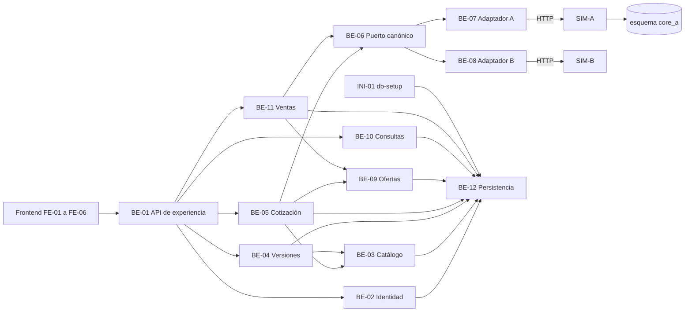

# Listado de módulos a desarrollar

Segunda entrega del TPI. **Estado: borrador para revisión.** Este listado reparte las operaciones del recorrido del Nivel 1 entre el frontend compartido, el backend intermediario, los dos simuladores y la inicialización local. Se basa en la arquitectura del [anexo técnico 2.2](../../fuentes/entrega-01/anexo-tecnico-v2-2.md) (§6 y §7), el [alcance por niveles](../../refinamiento/alcance-por-niveles-y-bases-de-extension.md), las [decisiones DER-03](../../refinamiento/decisiones-der-03.md) y el [esquema y DER](01-esquema-y-der.md). Las marcas **A**, **P**, **D**, **PN-xx** y **CP** tienen el mismo significado que en el esquema. El alcance está acotado a un Nivel 1 que una sola persona pueda construir, probar y defender.

## Criterios de división

- **Un frontend para todos los actores.** Cliente, operador y responsable usan la misma aplicación React. Las diferencias de permisos llegan desde el backend. (Acta; CA-N1-01)
- **Monolito modular.** Los módulos del backend son módulos NestJS del mismo despliegue. La API de experiencia no contiene reglas de negocio. (Anexo §6)
- **Los adaptadores no acceden a la base.** Traducen entre el contrato canónico y el contrato de su core. El módulo que orquesta persiste el resultado. Así un core nuevo agrega un adaptador sin tocar la persistencia. (Anexo PR-04)
- **Cada tabla tiene un módulo dueño.** Solo el dueño escribe en ella; los demás la leen. `db-setup` escribe la configuración inicial en nombre de los dueños.
- **Nivel de entrega.** «N1» es el compromiso de esta entrega. Un módulo puede ser N1 y crecer en niveles posteriores; eso se indica en la columna de nivel.

## Frontend compartido

| Código | Módulo | Responsabilidad | Depende de | Nivel |
| --- | --- | --- | --- | --- |
| FE-01 | Shell y selector de identidad | Navegación común y botonera de identidades sintéticas («Continuar como visitante», «Cliente Banco A», «Operador Banco A», «Responsable de configuración»). Muestra u oculta acciones según los permisos que informa el backend. Indica que la identidad es simulada. | BE-01 | N1. En N2 se reemplaza la botonera por inicio de sesión con Keycloak. |
| FE-02 | Formulario de cotización | Arma el formulario desde la configuración pública (versión de producto, revisión de perfil, modalidades, campos, opciones de suma). Envía la versión y la revisión con que se armó. Ante un 409, recarga la configuración y conserva los datos válidos. | BE-01 | N1 |
| FE-03 | Seguimiento y comparador | Muestra el número de seguimiento, el resultado de cada core («sin oferta para este riesgo», «no pudimos obtener una respuesta») y el comparador por categorías, con «No incluida» y «No informado». Muestra vencimiento, «Vencida» y si la oferta es vendible. Recibe todos los resultados juntos, al terminar la cotización. | BE-01 | N1. Publicación progresiva y avisos por ofertas tardías en N2. |
| FE-04 | Confirmación y estado de la solicitud | Confirma la oferta elegida con una clave de idempotencia y muestra el estado de la solicitud con los mensajes de DER-03 §2.3. Repetir la confirmación reutiliza la misma clave. | BE-01 | N1 |
| FE-05 | Consultas | Cotizaciones, ventas y trazabilidad de una operación. Solicitudes sin resolver con la acción **Verificar estado**. Avisos de plazo ajustado para el responsable de configuración. | BE-01 | N1. Filtros en N2; tablero en N3. |
| FE-06 | Panel de versiones | Para el responsable de configuración: ver la versión asignada por producto y canal, activar otra versión aprobada, volver a la anterior y ver el historial. | BE-01 | N1. El ciclo de publicación se suma en N2. |

## Backend intermediario

| Código | Módulo | Responsabilidad | Tablas o vistas de las que es dueño | Depende de | Nivel |
| --- | --- | --- | --- | --- | --- |
| BE-01 | API de experiencia | Expone los endpoints del frontend, agrega el contexto del actor, compone las respuestas por canal y perfil, traduce conflictos a 409. No contiene reglas de negocio. | — | BE-02, BE-03, BE-04, BE-05, BE-09, BE-10, BE-11 | N1 |
| BE-02 | Identidad y contexto | Resuelve el actor de la demo, su entidad, su cliente y sus permisos. Valida que un operador cotice solo para clientes de su entidad. | `entidad_comercial`, `actor`, `cliente` | BE-12 | N1 simulado; OIDC con Keycloak en N2. |
| BE-03 | Catálogo y configuración | Lee versiones de producto, perfiles y mapeos con sus revisiones vigentes. Resuelve el perfil aplicable (PN-06). Arma la configuración pública del formulario. Valida el riesgo con el esquema de la versión. | `producto`, `producto_version`, `perfil_comercial`, `perfil_comercial_revision`, `core`, `mapeo_core`, `mapeo_core_revision` | BE-12 | N1. Publicación y edición en N2 y N3. |
| BE-04 | Versiones y asignaciones | Resuelve la versión asignada por producto y canal. Activa y revierte con historial. Valida que la versión esté aprobada. Responde conflicto ante activaciones concurrentes. | `asignacion_version`, `asignacion_historial` | BE-02, BE-03, BE-12 | N1. Audiencia y reglas por rol o porcentaje en N3. |
| BE-05 | Cotización | Verifica versión de producto y revisión de perfil; crea la cotización y su única instancia; para cada core habilitado resuelve y valida la revisión de mapeo del producto y el core, y registra un intento; invoca a los cores en paralelo con timeout de 2 s; registra el resultado, los tiempos y la referencia de cada core; responde cuando todos los intentos terminaron. | `cotizacion`, `instancia_calculo`, `intento_core` | BE-02, BE-03, BE-04, BE-06, BE-09, BE-12, BE-13 | N1. Reintentos e idempotencia de creación en N2; recotización guiada en N3. |
| BE-06 | Puerto canónico y registro de adaptadores | Define la interfaz común para cotizar y solicitar, el resultado canónico y las capacidades de cada core. Elige el adaptador por `core.codigo`. Distingue una capacidad no soportada de una llamada fallida. | — | — | N1. Suite contractual reutilizable en N2. |
| BE-07 | Adaptador Core A | Traduce suma a `codPlan`, perfil a `codProductor` y provincia; convierte centavos; lee `validaHasta` por plan y marca un límite inválido; mapea códigos al estado canónico. Envía la solicitud con `Idempotency-Key = solicitud_venta.id` y `aceptarHasta`, con timeout de 3 s. | — | BE-06 | N1 · CP |
| BE-08 | Adaptador Core B | Traduce modalidad, provincia, suma como monto y descuento por perfil; envía `quotedOn` y la potencia de bicicleta eléctrica; calcula parámetros de referencia y huella; mapea códigos al estado canónico. No implementa solicitud. | — | BE-06 | N1 · CP |
| BE-09 | Ofertas y comparación | Normaliza cada respuesta en ofertas, componentes y prestaciones; asigna categorías según el mapeo; calcula límite de plataforma, vencimiento efectivo y origen; verifica el desglose; agrupa y ordena para el comparador; informa si la oferta es vendible. | `oferta`, `oferta_componente_premio`, `oferta_prestacion`, `v_oferta_estado` | BE-03, BE-12 | N1. Comparación de recotizaciones en N3. |
| BE-10 | Consultas y trazabilidad | Totales simples de cotizaciones y ventas; reconstrucción de una operación desde el número de seguimiento hasta intentos, ofertas, solicitudes y envíos; avisos de plazo ajustado; eventos de negocio. | `v_evento_negocio`, `v_aviso_plazo_ajustado`, `v_solicitud_sin_resolver` | BE-02, BE-12 | N1. Filtros en N2; tablero y exportación en N3 y N4. |
| BE-11 | Ventas simuladas | Registra la solicitud con idempotencia y una sola vigente por seguimiento; valida vigencia, core vendible y cliente; reconstruye el pedido con datos inmutables; envía y reenvía a A con timeout de 3 s; registra cada envío; aplica cada desenlace solo sobre estados no finales; permite la recuperación manual de una solicitud sin confirmar con **Verificar estado**. | `solicitud_venta`, `envio_solicitud` | BE-02, BE-06, BE-09, BE-10, BE-12, BE-13 | N1 · CP. Consulta de estado sin reenvío en N2; cupos y exclusividad en N3. |
| BE-12 | Persistencia y migraciones | Define el esquema, las migraciones, las restricciones, los triggers y las vistas de la base del intermediario. Da acceso transaccional a los demás módulos. | Esquema completo | — | N1 |
| BE-13 | Observabilidad básica | Logs estructurados con `correlationId`, `quotationId` y `attemptId`, sin tokens ni datos personales completos. Tiempos de cada llamada a un core. | — | — | N1 básico; métricas técnicas en N2; trazas en N3. |

## Simuladores de core

| Código | Módulo | Responsabilidad | Depende de | Nivel |
| --- | --- | --- | --- | --- |
| SIM-A | Simulador de Core A | Cotización recuperable con identificador, desglose completo y vigencia por plan; consulta por `cotizacionId`; solicitud idempotente que devuelve `RECIBIDA` o `RECHAZADA`, valida `aceptarHasta`, responde lo mismo a una clave repetida aunque lleguen dos pedidos a la vez y conserva sus claves después de un reinicio. Latencia y tasa de error configurables. Guarda su estado en el esquema `core_a`, con sus propias migraciones. | PostgreSQL (`core_a`) | N1 · CP |
| SIM-B | Simulador de Core B | Cotización volátil sin identificador, con premio total. Responde `NO_OPTIONS` y `NOT_ELIGIBLE` por separado. Aplica la regla de potencia de bicicleta eléctrica. Latencia y tasa de error configurables. No guarda estado. | — | N1 · CP |

## Inicialización local y pruebas

| Código | Módulo | Responsabilidad | Depende de | Nivel |
| --- | --- | --- | --- | --- |
| INI-01 | `db-setup` | Servicio de ejecución puntual. `db:migrate` aplica las migraciones de BE-12. `db:seed:demo` valida y carga entidades, actores, clientes, productos, versiones, perfiles, cores, mapeos y sus revisiones. Crea cada perfil o mapeo, inserta su revisión y completa el puntero vigente en la misma transacción. Al repetirse, no sobrescribe clientes, punteros vigentes ni asignaciones: solo completa lo que falta. Registra `CARGA_INICIAL`. Falla si una revisión existente llega con otro contenido. | BE-12, archivos de configuración en Git | N1 |
| INI-02 | Entorno local | Docker Compose con PostgreSQL, `db-setup`, API, frontend, SIM-A y SIM-B. `db-setup` espera a PostgreSQL sano y la API espera a que `db-setup` termine bien. Variables de latencia y error de los simuladores, timeout de cotización de 2 s, timeout de envío de 3 s y umbral de 5 s. Una réplica de la API. | INI-01 | N1 |
| PRB-01 | Pruebas | Pruebas contractuales de cada adaptador; prueba de doble venta y de confirmaciones concurrentes del mismo seguimiento; casos de aceptación 1, 1b, 2a, 2b y 3 de A; prueba de repetición de `db-setup`; smoke test; prueba de carga con el criterio del acta (sección siguiente). | Todos | N1 básico; umbrales automáticos y mayor carga en N2; estrés en N3. |

## Criterio de carga del Nivel 1

El acta fija una línea base reproducible de **al menos 5 flujos de cotización por segundo durante 3 minutos, con menos del 1 % de errores atribuibles a la plataforma**. El protocolo sigue el [refinamiento 5.13](../../refinamiento/05-13-criterios-y-prueba-de-rendimiento.md). **A** (criterio del acta), **P** (definiciones)

| Elemento | Definición propuesta |
| --- | --- |
| Flujo | Un `POST` de cotización válido de Movilidad, con identidad y datos sintéticos, que termina cuando la API responde con el resultado de los dos cores. Es el recorrido de la [sección 7.1 del esquema](01-esquema-y-der.md#71-cotización-que-recibe-ofertas-de-a-y-b). La venta se prueba aparte. |
| Carga | Llegada constante de 5 flujos por segundo durante 180 segundos: 900 flujos previstos, con un generador de tasa constante como k6. Si el generador descarta iteraciones o no sostiene la tasa, la ejecución no demuestra la línea base. |
| Entorno | Docker Compose local, una réplica de la API, latencias simuladas de 200 ms para A y 350 ms para B, cero errores inyectados, timeout de cotización de 2 s por core. Se documentan versiones y recursos de la máquina. |
| Error atribuible a la plataforma | Un flujo con respuesta 5xx, sin respuesta, sin el registro de los dos intentos, con una oferta asociada a otra cotización o con un resultado que no coincide con lo que devolvieron los cores. Cuenta aunque la API haya respondido 2xx. |
| Lo que no cuenta como error de plataforma | Un rechazo de negocio, una respuesta sin oferta o un timeout de un core causado por el simulador. Se informan por separado. |
| Aprobación | Al menos 900 flujos iniciados en 180 s y menos de 9 flujos (1 %) con error atribuible a la plataforma. Se informan además p50 y p95 de la respuesta, sin fijarles umbral en el Nivel 1. |
| Verificación | Después de la prueba, una consulta sobre `intento_core` confirma que cada cotización tiene dos intentos finalizados y que ningún intento quedó en `PENDIENTE`. |

## Operaciones del recorrido y módulo responsable

Cada operación tiene un módulo responsable. Los participantes colaboran sin ser dueños.

| # | Operación | Responsable | Participan | Tablas |
| --- | --- | --- | --- | --- |
| 1 | Preparar la base y la configuración inicial | INI-01 | BE-12 | Todas las de configuración |
| 2 | Seleccionar una identidad de demo | BE-02 | FE-01, BE-01 | `actor`, `cliente` |
| 3 | Obtener la configuración del formulario | BE-03 | FE-02, BE-01, BE-04 | `asignacion_version`, `producto_version`, `perfil_comercial_revision` |
| 4 | Crear la cotización y su instancia, verificando versión y revisión de perfil | BE-05 | FE-02, BE-01, BE-03, BE-04 | `cotizacion`, `instancia_calculo` |
| 5 | Resolver y validar la revisión de mapeo por producto y core, y registrar un intento por core | BE-05 | BE-03 | `intento_core` |
| 6 | Llamar a A y a B en paralelo y registrar el resultado de cada core | BE-05 | BE-06, BE-07, BE-08, SIM-A, SIM-B, BE-13 | `intento_core` |
| 7 | Normalizar ofertas, componentes y prestaciones | BE-09 | BE-03 | `oferta`, `oferta_componente_premio`, `oferta_prestacion` |
| 8 | Calcular vencimiento efectivo y origen | BE-09 | BE-03, BE-07 | `oferta` |
| 9 | Responder la cotización y comparar | BE-09 | FE-03, BE-01, BE-05 | `v_oferta_estado` |
| 10 | Confirmar una oferta y registrar la solicitud | BE-11 | FE-04, BE-01, BE-09 | `solicitud_venta` |
| 11 | Enviar la solicitud a A y aplicar el desenlace sobre estados no finales | BE-11 | BE-06, BE-07, SIM-A | `solicitud_venta`, `envio_solicitud` |
| 12 | Rechazar una segunda solicitud del mismo seguimiento | BE-11 | BE-12 | `solicitud_venta` |
| 13 | Mostrar solicitudes sin resolver | BE-10 | FE-05, BE-01 | `v_solicitud_sin_resolver` |
| 14 | Recuperar manualmente una solicitud sin confirmar: reenviar con **Verificar estado** o repitiendo la clave, aun si coinciden dos reenvíos | BE-11 | FE-04, FE-05, BE-07, SIM-A | `envio_solicitud`, `solicitud_venta` |
| 15 | Ver avisos de plazo ajustado | BE-10 | FE-05, BE-01 | `v_aviso_plazo_ajustado` |
| 16 | Activar una versión o hacer rollback | BE-04 | FE-06, BE-01, BE-02 | `asignacion_version`, `asignacion_historial` |
| 17 | Consultar cotizaciones, ventas y trazabilidad | BE-10 | FE-05, BE-01 | `v_evento_negocio` y tablas de operación |
| 18 | Registrar logs correlacionados | BE-13 | BE-05, BE-11 | — |
| 19 | Ejecutar la prueba de carga del acta | PRB-01 | INI-02, SIM-A, SIM-B | `intento_core` |

## Dependencias

## Diferido a niveles posteriores

| Módulo o capacidad | Nivel | Base que deja el Nivel 1 |
| --- | --- | --- |
| Reintentos de cotización | N2 | Un intento por core con su resultado y diagnóstico. |
| Publicación progresiva de ofertas y avisos por ofertas tardías | N2 | Estado y tiempos de cada intento; FE-03 ya muestra el resultado por core. |
| Inicio de sesión con Keycloak y autorización por roles | N2 | BE-02 ya resuelve permisos en el backend; `actor.acceso`. |
| Ciclo de publicación de versiones y revisiones | N2 | `estado_publicacion` y revisiones inmutables. |
| Consulta de estado en A sin reenviar | N2 | `envio_solicitud` y estado `DESCONOCIDA`. |
| Aviso de venta al cliente | N2 | `solicitud_venta.id`. |
| Métricas técnicas por adaptador y umbrales automáticos de carga | N2 | Tiempos en `intento_core` y logs de BE-13. |
| Recotización guiada de ofertas vencidas y volátiles, con motivo y referencias de origen | N3 | La instancia de cálculo y su número dentro de la cotización. |
| Cupos por cliente o core y exclusividad entre cores | N3 | Cliente, core, estado y fecha en `solicitud_venta`. |
| Administración de perfiles por entidad y CRM | N3 | Perfiles y revisiones con su entidad. |
| Asignación por audiencia, rol o porcentaje | N3 | BE-04 e historial de asignaciones. |
| Tablero técnico y comercial, OpenTelemetry | N3 | `v_evento_negocio` y logs correlacionados. |
| Tercer core o segunda familia de producto | N4 | Catálogo de cores, puerto canónico y `riesgo` validado por versión. |
